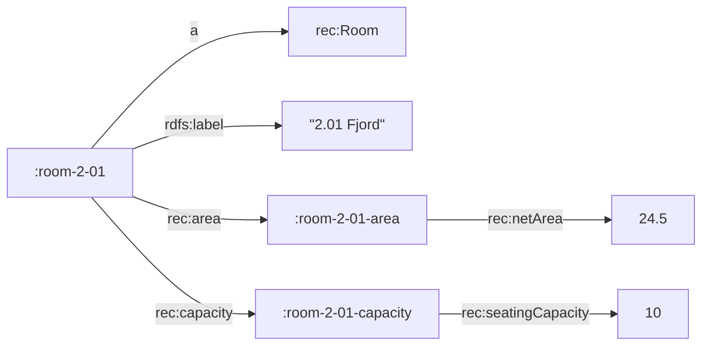

# 1. Rows as resources

In a relational database, a room is a row. Its table fixes its columns, its
primary key is an integer the database hands out, and a value the room
doesn't have is `NULL`. In RDF, the data model SPARQL queries, a room is a
**resource**: a thing with a name of its own, described by **statements**
about it, each statement one fact. This chapter keeps the question small
(which rooms seat ten or more?) and looks at what changes in how the data is
shaped and queried.

Everything up to [In Varve](#in-varve) is RDF and SPARQL as the W3C
standards define them, and holds in any RDF store. The queries run as
written against any SPARQL 1.1 endpoint loaded with the same data. The
sample, [`samples/learn/01-rows-as-resources`](../../samples/learn/01-rows-as-resources/Program.cs),
runs them in Varve, embedded, with nothing else installed, and every answer
on this page is what it printed.

## The table you would write

<!-- ci: example — the relational schema this chapter is set against, for comparison; no SQL runs -->
```sql
CREATE TABLE rooms (
  id         integer PRIMARY KEY,
  name       text NOT NULL,
  net_area   real,
  seats      integer
);

INSERT INTO rooms VALUES (1, '2.01 Fjord', 24.5, 10);
```

## The same room, as statements

Here is room 2.01 in TriG, a text syntax for RDF data:

<!-- ci: eng/ci.cs learn — source samples/learn/data/01-rooms.trig#room-2-01 -->
```trig
:room-2-01 a rec:Room ;
  rdfs:label "2.01 Fjord" ;
  rec:area :room-2-01-area ;
  rec:capacity :room-2-01-capacity .
:room-2-01-area a rec:ArchitectureArea ;
  rec:netArea "24.5"^^xsd:float .
:room-2-01-capacity a rec:ArchitectureCapacity ;
  rec:seatingCapacity 10 .
```

Read each line as *subject, predicate, object*. `:room-2-01 rdfs:label
"2.01 Fjord"` says that the room's label is "2.01 Fjord". A `;` repeats the
subject for the next statement, and `a` is short for `rdf:type`. The names
before a colon are prefixes, declared at the top of the file:

<!-- ci: eng/ci.cs learn — source samples/learn/data/01-rooms.trig#prefixes -->
```trig
PREFIX rec:  <https://w3id.org/rec#>
PREFIX rdfs: <http://www.w3.org/2000/01/rdf-schema#>
PREFIX xsd:  <http://www.w3.org/2001/XMLSchema#>
PREFIX :     <https://example.org/learn/>
```

So `rec:Room` is `https://w3id.org/rec#Room`, a class of RealEstateCore
(REC), the building vocabulary this track uses throughout. Five things are
different from the row.

- **The key is a name, not a number.** `:room-2-01` stands for
  `https://example.org/learn/room-2-01`, an IRI. You choose it; no sequence
  hands it out. It means the same room in every dataset, in every file and
  in every query, which an `id` of `1` does only inside one table.
- **The type is a statement too.** There is no `rooms` table. `:room-2-01 a
  rec:Room` is one more fact about the room, stored like the label.
- **A value can be a small row of its own.** REC doesn't give a room a
  `net_area` column. It gives it an *area*, `:room-2-01-area`, which is a
  resource with a type of its own (`rec:ArchitectureArea`) and properties of
  its own (`rec:netArea`, and in REC also gross and rentable area). Read it
  as a one-to-one side table, `room_areas(room_id, net_area)`, whose row has
  a name. REC requires that name: its shapes refuse an area that is not an
  IRI. Capacity has the same pattern.
- **A missing value is a missing statement.** Room 2.03, the kitchen, has no
  capacity. There is no `NULL` stored for it; the statement isn't there.
- **Every literal has a datatype.** `"24.5"^^xsd:float` is the float 24.5,
  and `10` is short for `"10"^^xsd:integer`. There is no column type for a
  value to be converted to: the type travels with the value.

<!-- ci: example — a diagram of room 2.01's statements, drawn by the docs site -->


## One room, turned sideways

`SELECT * FROM rooms WHERE id = 1` gives one row with a column per value.
The nearest SPARQL asks for every statement whose subject is the room:

<!-- ci: eng/ci.cs learn — source samples/learn/01-rows-as-resources/queries/one-room.rq -->
```sparql
PREFIX : <https://example.org/learn/>

SELECT ?property ?value
WHERE { :room-2-01 ?property ?value }
ORDER BY ?property
```

<!-- ci: eng/ci.cs learn — output samples/learn/01-rows-as-resources/expected/one-room.txt -->
```text
property     | value
-------------+--------------------
rdf:type     | rec:Room
rdfs:label   | 2.01 Fjord
rec:area     | :room-2-01-area
rec:capacity | :room-2-01-capacity
(4 rows)
```

The row comes back sideways: one line per statement. The area and the
capacity are names of other resources, not values. Getting the numbers
means following them, which is the next query.

## Which rooms seat ten or more?

<!-- ci: example — the SQL this query is set against, for comparison -->
```sql
SELECT id, name, seats FROM rooms WHERE seats >= 10 ORDER BY name;
```

<!-- ci: eng/ci.cs learn — source samples/learn/01-rows-as-resources/queries/rooms-seating-ten.rq -->
```sparql
PREFIX rec:  <https://w3id.org/rec#>
PREFIX rdfs: <http://www.w3.org/2000/01/rdf-schema#>

SELECT ?room ?name ?seats
WHERE {
  ?room a rec:Room ;
        rdfs:label ?name ;
        rec:capacity ?capacity .
  ?capacity rec:seatingCapacity ?seats .
  FILTER (?seats >= 10)
}
ORDER BY ?name
```

<!-- ci: eng/ci.cs learn — output samples/learn/01-rows-as-resources/expected/rooms-seating-ten.txt -->
```text
room       | name             | seats
-----------+------------------+------
:room-2-01 | 2.01 Fjord       | 10
:room-2-02 | 2.02 Open office | 40
:room-3-02 | 3.02 Open office | 36
(3 rows)
```

A SPARQL query is a pattern of statements with variables (`?room`,
`?seats`) in some places. The answer is every way of filling the variables
so that each statement in the pattern is in the data. The pattern above
has a join in it: `?room rec:capacity ?capacity` and `?capacity
rec:seatingCapacity ?seats` share `?capacity`, the way `rooms` would join
`room_capacities` on `room_id`.

The kitchen isn't in the answer. It has no capacity, so the pattern can't
be filled for it, which is what an inner join would do too.

## Every room, seats if known

`LEFT JOIN` is `OPTIONAL`:

<!-- ci: eng/ci.cs learn — source samples/learn/01-rows-as-resources/queries/every-room.rq -->
```sparql
PREFIX rec:  <https://w3id.org/rec#>
PREFIX rdfs: <http://www.w3.org/2000/01/rdf-schema#>

SELECT ?name ?area ?seats
WHERE {
  ?room a rec:Room ;
        rdfs:label ?name ;
        rec:area ?a .
  ?a rec:netArea ?area .
  OPTIONAL { ?room rec:capacity ?c . ?c rec:seatingCapacity ?seats }
}
ORDER BY ?name
```

<!-- ci: eng/ci.cs learn — output samples/learn/01-rows-as-resources/expected/every-room.txt -->
```text
name             | area             | seats
-----------------+------------------+------
2.01 Fjord       | 24.5^^xsd:float  | 10
2.02 Open office | 310.0^^xsd:float | 40
2.03 Kitchen     | 16.0^^xsd:float  |
3.01 Harbour     | 18.0^^xsd:float  | 6
3.02 Open office | 290.0^^xsd:float | 36
(5 rows)
```

The kitchen's seats are **unbound**: the variable has no value in that
solution. That is the closest thing to `NULL`, and like `NULL` it exists
only in an answer, never in the data.

## Inserting a room

`INSERT INTO` is `INSERT DATA`, in SPARQL Update:

<!-- ci: eng/ci.cs learn — source samples/learn/01-rows-as-resources/queries/insert.ru -->
```sparql
PREFIX rec:  <https://w3id.org/rec#>
PREFIX rdfs: <http://www.w3.org/2000/01/rdf-schema#>
PREFIX xsd:  <http://www.w3.org/2001/XMLSchema#>
PREFIX :     <https://example.org/learn/>

INSERT DATA {
  :room-3-03 a rec:Room ;
    rdfs:label "3.03 Phone booth" ;
    rec:area :room-3-03-area ;
    rec:capacity :room-3-03-capacity .
  :room-3-03-area a rec:ArchitectureArea ;
    rec:netArea "3.0"^^xsd:float .
  :room-3-03-capacity a rec:ArchitectureCapacity ;
    rec:seatingCapacity 1 .
}
```

After it, counting the rooms:

<!-- ci: eng/ci.cs learn — source samples/learn/01-rows-as-resources/queries/count-rooms.rq -->
```sparql
PREFIX rec: <https://w3id.org/rec#>

SELECT (COUNT(?room) AS ?rooms)
WHERE { ?room a rec:Room }
```

<!-- ci: eng/ci.cs learn — output samples/learn/01-rows-as-resources/expected/insert.txt -->
```text
rooms
-----
6
(1 row)
```

`INSERT DATA` takes statements as they are, with no variables. Chapter 4
uses `DELETE … INSERT … WHERE`, which works out what to change from a
pattern, the way `UPDATE … WHERE` does.

## Nothing checks a value

A table refuses `'ten'` in an `integer` column. RDF has no columns to
refuse it: a store with no schema declared accepts any statement. So this
update succeeds, here in a second, empty dataset:

<!-- ci: eng/ci.cs learn — source samples/learn/01-rows-as-resources/queries/unchecked.ru -->
```sparql
PREFIX rec:  <https://w3id.org/rec#>
PREFIX rdfs: <http://www.w3.org/2000/01/rdf-schema#>
PREFIX :     <https://example.org/learn/>

INSERT DATA {
  :room-9-99 a rec:Room ;
    rdfs:label "9.99 Nowhere" ;
    rec:capacity :room-9-99-capacity .
  :room-9-99-capacity rec:seatingCapacity "ten" .
}
```

<!-- ci: eng/ci.cs learn — source samples/learn/01-rows-as-resources/queries/unchecked.rq -->
```sparql
PREFIX rec: <https://w3id.org/rec#>

SELECT ?seats ?tenOrMore
WHERE {
  ?c rec:seatingCapacity ?seats .
  BIND (?seats >= 10 AS ?tenOrMore)
}
```

<!-- ci: eng/ci.cs learn — output samples/learn/01-rows-as-resources/expected/nothing-checks-a-value.txt -->
```text
seats | tenOrMore
------+----------
ten   |
(1 row)
```

The comparison `"ten" >= 10` is an error in SPARQL, and an error in an
expression leaves the variable unbound. It doesn't stop the query, and it
doesn't make the comparison false. So `FILTER (?seats >= 10)` silently
drops the room, rather than reporting bad data.

Values are checked against a schema only when one is declared. In RDF that
schema is a set of SHACL shapes, and REC publishes its own: chapter 3
binds them to the dataset so that a commit like this one is refused. Until
then nothing stops a typo in a predicate's name either: a seating capacity
written with the predicate misspelt is stored as a statement like any
other, and no query for `rec:seatingCapacity` finds it.

## In Varve

The sample runs the queries above in Varve, embedded in the process, with
the dataset in memory. It creates the dataset and loads the TriG file as
one commit:

<!-- ci: eng/ci.cs learn — source samples/learn/01-rows-as-resources/Program.cs#create -->
```csharp
await using Dataset dataset = await Dataset.CreateAsync(
    new MemoryStorage(),
    new DatasetId(Guid.NewGuid()),
    new DatasetOptions { Clock = TimeProvider.System });

CommitResult loaded = await Load.TriGAsync(dataset, Path.Combine(AppContext.BaseDirectory, "data", "01-rooms.trig"));
```

The loader parses the file with `Varve.Turtle` and commits every statement
in it at once:

<!-- ci: eng/ci.cs learn — source samples/learn/Shared/Load.cs#load -->
```csharp
/// <summary>Parses <paramref name="path"/> and commits every quad in it as one commit.</summary>
internal static async ValueTask<CommitResult> TriGAsync(Dataset dataset, string path)
{
    CommitRequestBuilder commit = new();
    ParseResult parsed = TurtleParser.Parse(
        File.ReadAllBytes(path),
        (in QuadView quad) => commit.Assert(
            quad.Subject.Materialise(),
            quad.Predicate.Materialise(),
            quad.Object.Materialise()),
        new TurtleOptions { Syntax = RdfSyntax.TriG });
    if (!parsed.Succeeded)
    {
        throw new InvalidDataException(path + ": " + parsed.FirstError);
    }

    return await dataset.CommitAsync(commit);
}
```

An update runs through `SparqlUpdate`:

<!-- ci: eng/ci.cs learn — source samples/learn/01-rows-as-resources/Program.cs#update -->
```csharp
CommitResult inserted = await SparqlUpdate.ExecuteAsync(
    dataset, SparqlParser.ParseUpdate(Show.File("insert.ru")), new UpdateOptions());
```

Each of the two writes is a **commit**, and Varve numbers its commits:

<!-- ci: eng/ci.cs learn — output samples/learn/01-rows-as-resources/expected/in-varve.txt -->
```text
loaded:   Committed at position 1
inserted: Committed at position 2
```

One SPARQL Update request is one commit, however many statements it
writes. The positions matter from chapter 4 on: Varve keeps every commit,
and chapter 6 reads the data as it was at an earlier one.

`MemoryStorage` keeps everything in the process and loses it at exit. A
dataset on disk is the same call with a `FileStorage`, and chapter 10 puts
the same data on a server, where the queries go over the SPARQL protocol
unchanged.

From a clone of the repository:

<!-- ci: eng/ci.cs learn — eng/learn.cs --run runs every sample this way and compares its output with the page -->
```bash
dotnet run --project samples/learn/01-rows-as-resources
```

In a project of your own, the sample needs three packages:

<!-- ci: none — a project of the reader's own; the samples reference the same packages by VarveReference -->
```bash
dotnet add package Varve.Store --prerelease
dotnet add package Varve.Turtle --prerelease
dotnet add package Varve.Sparql.Store --prerelease
```

The data is [`samples/learn/data/01-rooms.trig`](../../samples/learn/data/01-rooms.trig),
the queries are in [`queries/`](../../samples/learn/01-rows-as-resources/queries/one-room.rq),
and the helpers every sample shares, the loader above and the printer of
tables, are in [`samples/learn/Shared/`](../../samples/learn/Shared/Show.cs).

## Not run in CI

- `dotnet add package …`: it is run in a project of the reader's own. Every
  sample references the same packages, and CI builds them from this
  repository.

## Next

[Chapter 2, links and patterns](02-links-and-patterns.md), puts the rooms
on levels in a building, and asks for every room in it without a recursive
CTE.
