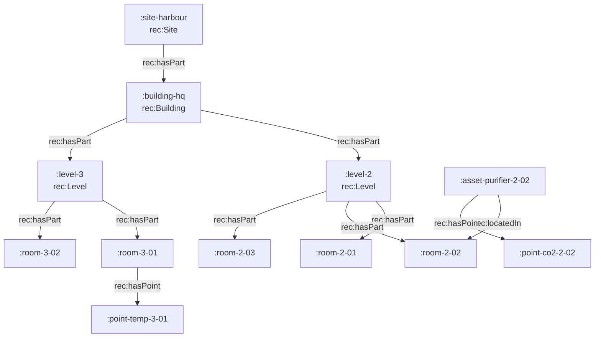

# 2. Links and patterns

Chapter 1's rooms stood alone. Here they get a place: a site, a building on
it, and two levels holding the rooms. Some rooms get assets, things located
in them, and the rooms and assets get points, the sensors a building
system reads. In a relational schema, that is foreign keys and, to walk a
hierarchy of unknown depth, a recursive CTE. In Varve, a link is one more
statement whose object is another resource, and walking it is a **property
path**.

The sample is [`samples/learn/02-links-and-patterns`](../../samples/learn/02-links-and-patterns/Program.cs).

## The schema you would write

A hierarchy whose depth varies from building to building usually ends up
as one table with a parent column:

<!-- ci: example — the relational schema this chapter is set against, for comparison; Varve runs no SQL -->
```sql
CREATE TABLE spaces (
  id         integer PRIMARY KEY,
  parent_id  integer REFERENCES spaces (id),
  kind       text NOT NULL,          -- 'site', 'building', 'level', 'room'
  name       text NOT NULL
);

CREATE TABLE assets (
  id         integer PRIMARY KEY,
  space_id   integer NOT NULL REFERENCES spaces (id),
  name       text NOT NULL
);
```

## The topology, as links

<!-- ci: eng/ci.cs learn — source samples/learn/data/02-topology.trig#topology -->
```trig
:site-harbour a rec:Site ;
  rdfs:label "Harbour Point" ;
  rec:hasPart :building-hq .

:building-hq a rec:Building ;
  rdfs:label "Harbour House" ;
  rec:hasPart :level-2 , :level-3 .

:level-2 a rec:Level ;
  rdfs:label "Level 2" ;
  rec:levelNumber 2 ;
  rec:hasPart :room-2-01 , :room-2-02 , :room-2-03 .

:level-3 a rec:Level ;
  rdfs:label "Level 3" ;
  rec:levelNumber 3 ;
  rec:hasPart :room-3-01 , :room-3-02 .
```

`rec:hasPart` links a whole to a part: the site has the building, the
building has its levels, a level has its rooms. The objects `:level-2` and
`:room-2-01` are names of resources, the same names chapter 1 gave the
rooms, so these statements join up with chapter 1's without a key column on
either side. `rec:levelNumber 2` is a plain value, and `rec:Site`,
`rec:Building` and `rec:Level` are REC's classes for the places a room sits
in.

<!-- ci: example — a diagram of the slice's topology, drawn by the docs site -->


## Assets and points

<!-- ci: eng/ci.cs learn — source samples/learn/data/02-topology.trig#assets-and-points -->
```trig
:asset-display-2-01 a rec:Asset ;
  rdfs:label "Display, 2.01" ;
  rec:locatedIn :room-2-01 .

:asset-display-3-01 a rec:Asset ;
  rdfs:label "Display, 3.01" ;
  rec:locatedIn :room-3-01 .

:asset-purifier-2-02 a rec:Asset ;
  rdfs:label "Air purifier, 2.02" ;
  rec:locatedIn :room-2-02 ;
  rec:hasPoint :point-co2-2-02 .

:room-2-01 rec:hasPoint :point-temp-2-01 .
:room-3-01 rec:hasPoint :point-temp-3-01 .
:room-3-02 rec:hasPoint :point-temp-3-02 .

:point-temp-2-01 a brick:Temperature_Sensor ; rdfs:label "Temperature, 2.01" .
:point-temp-3-01 a brick:Temperature_Sensor ; rdfs:label "Temperature, 3.01" .
:point-temp-3-02 a brick:Temperature_Sensor ; rdfs:label "Temperature, 3.02" .
:point-co2-2-02  a brick:CO2_Sensor ;         rdfs:label "CO2, air purifier 2.02" .
```

An asset is `rec:locatedIn` a room. A room or an asset `rec:hasPoint` a
point: a temperature sensor, a CO₂ sensor. A point's classes come from
Brick, the vocabulary REC takes its points and equipment from, so they have
the prefix `brick:`. Here they are two plain classes. Brick arranges them in
a hierarchy, sensors under points, and chapter 3 uses it.

What the dataset holds is the point itself: its name, its type, and where
it is. Not its readings. A temperature sensor sends a value every few
seconds, and those values belong in a time-series store, joined to this
dataset by the point's IRI. Chapter 7 draws that line.

The sample loads the two files as two commits:

<!-- ci: eng/ci.cs learn — source samples/learn/02-links-and-patterns/Program.cs#load -->
```csharp
CommitResult rooms = await Load.TriGAsync(dataset, Path.Combine(AppContext.BaseDirectory, "data", "01-rooms.trig"));
CommitResult topology = await Load.TriGAsync(dataset, Path.Combine(AppContext.BaseDirectory, "data", "02-topology.trig"));
```

<!-- ci: eng/ci.cs learn — output samples/learn/02-links-and-patterns/expected/loaded.txt -->
```text
rooms:    Committed at position 1
topology: Committed at position 2
```

## Every room in the building

<!-- ci: example — the recursive CTE this query is set against, for comparison -->
```sql
WITH RECURSIVE parts (id) AS (
  SELECT id FROM spaces WHERE parent_id = 2            -- the building
  UNION
  SELECT s.id FROM spaces s JOIN parts p ON s.parent_id = p.id
)
SELECT level.name AS level, room.name
FROM parts
JOIN spaces room  ON room.id = parts.id AND room.kind = 'room'
JOIN spaces level ON level.id = room.parent_id
ORDER BY room.name;
```

<!-- ci: eng/ci.cs learn — source samples/learn/02-links-and-patterns/Program.cs#rooms-in-the-building -->
```csharp
Show.Query(view, """
    PREFIX rec:  <https://w3id.org/rec#>
    PREFIX rdfs: <http://www.w3.org/2000/01/rdf-schema#>
    PREFIX :     <https://example.org/learn/>
    SELECT ?level ?name
    WHERE {
      :building-hq rec:hasPart+ ?room .
      ?room a rec:Room ;
            rdfs:label ?name .
      ?level rec:hasPart ?room .
    }
    ORDER BY ?name
    """);
```

<!-- ci: eng/ci.cs learn — output samples/learn/02-links-and-patterns/expected/rooms-in-the-building.txt -->
```text
level    | name
---------+-----------------
:level-2 | 2.01 Fjord
:level-2 | 2.02 Open office
:level-2 | 2.03 Kitchen
:level-3 | 3.01 Harbour
:level-3 | 3.02 Open office
(5 rows)
```

`rec:hasPart+` is the property path *one or more `rec:hasPart` links*. It
matches the levels as well as the rooms, so the pattern keeps only the
`?room` that is `a rec:Room`. That does the work of the CTE's `kind =
'room'`. The depth is whatever the data has. A path with a cycle in it
still ends: a path finds each resource once, however many routes lead to
it. `*` is *zero or more*, so `rec:hasPart*` would include the building
itself.

## Every asset on level 3

<!-- ci: eng/ci.cs learn — source samples/learn/02-links-and-patterns/Program.cs#assets-on-level-3 -->
```csharp
Show.Query(view, """
    PREFIX rec:  <https://w3id.org/rec#>
    PREFIX rdfs: <http://www.w3.org/2000/01/rdf-schema#>
    PREFIX :     <https://example.org/learn/>
    SELECT ?asset ?name ?room
    WHERE {
      :level-3 rec:hasPart+ ?room .
      ?asset rec:locatedIn ?room ;
             rdfs:label ?name .
    }
    ORDER BY ?name
    """);
```

<!-- ci: eng/ci.cs learn — output samples/learn/02-links-and-patterns/expected/assets-on-level-3.txt -->
```text
asset               | name          | room
--------------------+---------------+-----------
:asset-display-3-01 | Display, 3.01 | :room-3-01
(1 row)
```

The path walks down from the level, and an ordinary statement pattern
joins the assets to the rooms it reaches.

## Every point in the building

A point hangs either on a room or on an asset in a room. In SQL that is a
`UNION` of two joins. A path can say *either* with `|`, and *backwards* with
`^`:

<!-- ci: eng/ci.cs learn — source samples/learn/02-links-and-patterns/Program.cs#points-in-the-building -->
```csharp
Show.Query(view, """
    PREFIX rec:  <https://w3id.org/rec#>
    PREFIX :     <https://example.org/learn/>
    SELECT ?space ?point ?type
    WHERE {
      :building-hq rec:hasPart+ ?space .
      ?space (rec:hasPoint | ^rec:locatedIn/rec:hasPoint) ?point .
      ?point a ?type .
    }
    ORDER BY ?space ?point
    """);
```

<!-- ci: eng/ci.cs learn — output samples/learn/02-links-and-patterns/expected/points-in-the-building.txt -->
```text
space      | point            | type
-----------+------------------+-------------------------
:room-2-01 | :point-temp-2-01 | brick:Temperature_Sensor
:room-2-02 | :point-co2-2-02  | brick:CO2_Sensor
:room-3-01 | :point-temp-3-01 | brick:Temperature_Sensor
:room-3-02 | :point-temp-3-02 | brick:Temperature_Sensor
(4 rows)
```

`^rec:locatedIn/rec:hasPoint` reads: follow `rec:locatedIn` backwards, from
the room to an asset in it, then `rec:hasPoint` forwards. Room 2.02 has no
point of its own; its CO₂ sensor is on the air purifier located in it.

## Where is room 3.01?

Walking up is the same path, backwards:

<!-- ci: eng/ci.cs learn — source samples/learn/02-links-and-patterns/Program.cs#where-is-3-01 -->
```csharp
Show.Query(view, """
    PREFIX rec:  <https://w3id.org/rec#>
    PREFIX :     <https://example.org/learn/>
    SELECT ?container ?type
    WHERE {
      :room-3-01 ^rec:hasPart+ ?container .
      ?container a ?type .
    }
    ORDER BY ?container
    """);
```

<!-- ci: eng/ci.cs learn — output samples/learn/02-links-and-patterns/expected/where-is-3-01.txt -->
```text
container     | type
--------------+-------------
:building-hq  | rec:Building
:level-3      | rec:Level
:site-harbour | rec:Site
(3 rows)
```

## A link is stored in one direction

REC also has `rec:isPartOf`, the opposite of `rec:hasPart`, and
`rec:isLocationOf`, the opposite of `rec:locatedIn`. A SQL developer may
expect the database to keep the two directions in step, the way a foreign
key reads from either end. **Varve does not.** It stores the statements it
was given, and the slice states only `rec:hasPart`:

<!-- ci: eng/ci.cs learn — source samples/learn/02-links-and-patterns/Program.cs#no-inverse -->
```csharp
Show.Query(view, """
    PREFIX rec:  <https://w3id.org/rec#>
    PREFIX :     <https://example.org/learn/>
    SELECT (COUNT(?container) AS ?stated)
    WHERE { :room-3-01 rec:isPartOf ?container }
    """);
```

<!-- ci: eng/ci.cs learn — output samples/learn/02-links-and-patterns/expected/no-inverse.txt -->
```text
stated
------
0
(1 row)
```

Either query the direction that is stored, with `^` as above, or state
both directions when writing. The generated portfolio from chapter 3 on
states both.

Deriving one direction from the other would take a rule saying the two
are opposites (OWL's `owl:inverseOf`) and inference to apply it. REC 4's
files don't state that rule.

<!-- unshipped: #95 -->
> **Not in this release.** Varve's inference doesn't apply `owl:inverseOf`
> yet: that is the materialised closure of the Inference milestone, #95.
> Chapter 12, which that milestone writes, covers it.

## There is no foreign key

`REFERENCES spaces (id)` refuses an asset in a room that doesn't exist.
Nothing here does: a link to a name that nothing describes is a statement
like any other. This commit, in a second dataset made for the purpose,
succeeds:

<!-- ci: eng/ci.cs learn — source samples/learn/02-links-and-patterns/Program.cs#no-foreign-key -->
```csharp
await using (Dataset scratch = await Dataset.CreateAsync(
    new MemoryStorage(), new DatasetId(Guid.NewGuid()), new DatasetOptions { Clock = TimeProvider.System }))
{
    CommitResult accepted = await SparqlUpdate.ExecuteAsync(scratch, SparqlParser.ParseUpdate("""
        PREFIX rec:  <https://w3id.org/rec#>
        PREFIX :     <https://example.org/learn/>
        INSERT DATA { :asset-lost a rec:Asset ; rec:locatedIn :room-9-99 . }
        """), new UpdateOptions());
    Console.WriteLine(accepted.Outcome + " at position " + accepted.Position.Value);
}
```

<!-- ci: eng/ci.cs learn — output samples/learn/02-links-and-patterns/expected/no-foreign-key.txt -->
```text
Committed at position 1
```

That is by design, because a link may name something described in another
dataset, or by another system altogether (chapter 11 builds on it). When a
link *must* reach something of a given class, say so in a shape, and the
dataset refuses a commit that breaks it: chapter 3.

## Running it

From a clone of the repository:

<!-- ci: eng/ci.cs learn — eng/learn.cs --run runs every sample this way and compares its output with the page -->
```bash
dotnet run --project samples/learn/02-links-and-patterns
```

The data is [`samples/learn/data/02-topology.trig`](../../samples/learn/data/02-topology.trig),
loaded after [chapter 1's rooms](../../samples/learn/data/01-rooms.trig).

## Next

Chapter 3, schema without migrations, loads a generated portfolio of many
buildings, adds a new kind of asset without an `ALTER TABLE`, and binds
REC's shapes to the dataset so that a commit breaking them is refused.

